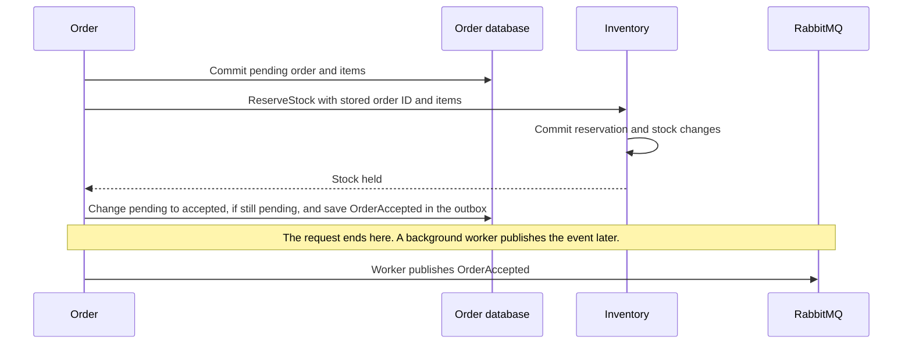
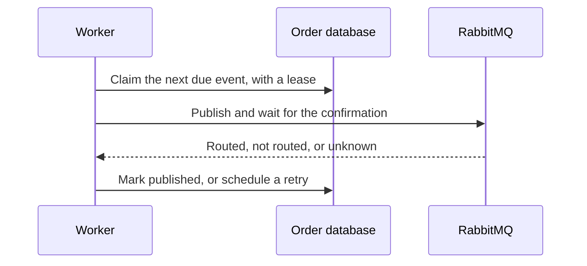

# Architecture

The [README](README.md#system-overview) covers the system overview and the main design
choices. This document explains how those choices work under failure, which alternatives
were considered, and where the implementation still falls short.

- [Contracts belong to the service responsible for them](#contracts-belong-to-the-service-responsible-for-them)
- [A pending order makes an interrupted request resumable](#a-pending-order-makes-an-interrupted-request-resumable)
- [Inventory checks availability while changing stock](#inventory-checks-availability-while-changing-stock)
- [An accepted order's event is saved with it](#an-accepted-orders-event-is-saved-with-it)
- [Consumers choose their subscriptions and retry policy](#consumers-choose-their-subscriptions-and-retry-policy)
- [Notification claims prevent duplicates within limits](#notification-claims-prevent-duplicates-within-limits)
- [Tests check the boundaries where failures happen](#tests-check-the-boundaries-where-failures-happen)
- [Trade-offs and remaining work](#trade-offs-and-remaining-work)

## Contracts belong to the service responsible for them

Inventory provides the ability to reserve stock, so it owns `ReserveStock`. Order is
the authority on whether an order was accepted, so it owns `OrderAccepted`. The ownership
rule follows what each message means:

| | Command | Event |
| --- | --- | --- |
| Meaning | “Do this” | “This happened” |
| Destination | One responsible receiver | Any interested consumers |
| Owner | The receiver that provides the capability | The producer that knows the fact |
| Here | Inventory owns `ReserveStock` | Order owns `OrderAccepted` |

Why not have order send a `SendNotification` command? That would make order responsible
for requesting an email and knowing what the notification service needs. With an event,
order announces acceptance; notification chooses the template and delivery channel.
Another consumer can react to the same event without changing order's workflow.

### Share the contract without sharing the implementation

The contracts live in separate Go modules:
[`inventory-service/api`](inventory-service/api) and
[`order-service/api`](order-service/api). A consumer imports generated messages and,
for inventory, the gRPC client. It does not import the other service's application code.

One shared contracts module would make unrelated APIs part of the same dependency.
Copying schemas into each consumer would create definitions that could drift apart.
Service-owned modules give each contract one definition and one responsible owner.

Local `replace` directives make consumers compile against the contracts in the same
checkout. Removing an RPC that order still calls therefore fails in the same pull
request. Each contract also has its own Buf workspace, so the schemas cannot silently
import each other through a shared root workspace. The cost is maintaining configuration
in each module.

### A message must still make sense to an older consumer

`OrderAccepted` carries the data needed to send the confirmation, including the amount
at acceptance. Notification can process it without calling order or looking up today's
catalog prices. The event is a defined message, rather than a serialization of the whole
order object, so internal refactoring does not automatically change the public API.

Adding a protobuf field can preserve the wire format and still break a consumer's
assumptions. For example, an event already waiting in a queue cannot contain a field
added tomorrow. The new consumer must handle that field being absent.

The contract therefore requires that new fields work when missing, removed field numbers
are reserved, and changes to an existing field's meaning use a new version. Versioned
schemas and routing keys allow old and new consumers to coexist during a migration;
that migration still needs an explicit plan.

`buf breaking` checks schema compatibility. It cannot detect a changed Go string such
as the routing key, or a changed business meaning. Tests pin the routing constants;
review must catch changes in meaning. Generated types are translated at the adapters,
keeping wire-format changes out of the use cases.

See the [event contract](order-service/api/proto/order/v1/order_accepted.proto) and
[routing-contract tests](order-service/api/orderevents/topic_test.go).

## A pending order makes an interrupted request resumable

Order-service saves the order and its items before calling inventory. That gives every
attempt the same stored order ID and basket, even if the client disconnects or a reply
is lost.

**No database transaction stays open across the inventory call.** Keeping one open
would hold database resources while waiting on the network. It would not make the
inventory database roll back if the order database failed later.

Instead, each database commits its own changes. The workflow must account for the gaps
between those commits:

| What happens | State left behind | Recovery |
| --- | --- | --- |
| The initial order insert fails | Inventory has not been called | Retry through the order API; its idempotency key identifies any committed order. |
| Inventory commits, but its reply is lost | Order is pending; stock is held | Repeat the stored order ID and items. Inventory recognizes the successful reservation. |
| Inventory succeeds, but saving acceptance fails | Stock may be held while order remains pending | A later request resumes the stored order and tries to complete it. |
| Two requests finish the same pending order | Both try to change its status | The update requires the expected `pending` state; the loser reloads the winner's result. |
| Saving the event fails after the status change | Nothing: both are one transaction | The acceptance rolls back with the event, and the order stays pending for a later request. |
| Acceptance commits, but publication fails | Order is accepted; its event waits in the outbox | The worker retries it (see below). An accepted replay does not record a second event. |

For example, if the client retries after a timeout with a changed basket, a pending
order resumes with the items already stored. The new request body does not replace them.
This preserves the reservation identity, although the API does not currently report
that the client reused its key with a different body.

Pending-order recovery currently depends on another client request. The outbox worker
only publishes events; nothing in the background finds unfinished orders and resumes
them, and there is no inventory release operation to undo a stranded reservation.

### Retry an uncertain outcome, not a stock refusal

The inventory adapter uses gRPC status codes to decide what order-service does next:

| Response | Action |
| --- | --- |
| `UNAVAILABLE` or `DEADLINE_EXCEEDED` | Retry with the same order ID and items, within the bounded retry budget. |
| `FAILED_PRECONDITION` for insufficient stock | Record rejection and return the refusal. |
| Unknown SKU, invalid request, or conflicting use of an order ID | Return an error without retrying the unchanged request. |
| `INTERNAL` | Return an error without automatic retry. |

Each attempt has its own timeout within the caller's lifetime. A timeout means the caller
does not know the outcome; inventory may already have committed. In contrast, an explicit
stock refusal is an answer, so repeating it immediately only adds load.

Not retrying `INTERNAL` avoids amplifying server faults. The cost is that transient
storage errors mapped to that status also need a later client replay. Error details
explain shortfalls or invalid fields, but the status code controls retry behavior, so
callers can still act when those details are unavailable.

See [order creation](order-service/internal/order/application/create_order.go) and the
[inventory adapter](order-service/internal/order/adapter/outbound/inventorygrpc/reserver.go).

## Inventory checks availability while changing stock

The README shows the conditional `UPDATE` and the sorted SKU order. The important database
behavior is what happens when two orders compete for the last unit:

1. Both requests try to increase `reserved`, provided enough stock remains.
2. The first update locks the stock row. The second waits.
3. If the first transaction commits, PostgreSQL rechecks the second update's `WHERE`
   condition against the updated row under `READ COMMITTED`.
4. No stock remains, so the second update affects zero rows and the request is refused.

The update itself acquires the necessary row lock. A separate `SELECT ... FOR UPDATE`
would add a step without making this availability check stronger. `SERIALIZABLE` is
also unnecessary for this invariant: the condition and the change are one operation.

All basket lines and their reservation records share one transaction. If a later line
cannot be filled, earlier changes roll back. Sorting the lines prevents overlapping
baskets from locking their stock rows in opposite orders.

### Remember success so a lost reply does not reserve twice

For identical concurrent baskets, the reservation insert uses
`ON CONFLICT (order_id, product_sku) DO NOTHING`. If another transaction is inserting the
same key, the insert waits for it to finish. If that transaction commits, the loser
inserts nothing, rolls back its attempt, and rereads the stored basket.

A raw unique-violation error would abort the transaction. `ON CONFLICT` makes losing the
claim an expected result that the application can handle explicitly.

Only successful reservations are stored. After an insufficient-stock refusal, an
inventory request can succeed following restocking. Storing the refusal permanently
under that ID would prevent this. The order API has a different policy: once an order is
stored as `rejected`, replaying its client key returns rejection without calling
inventory again. Restocking does not reopen a rejected order.

### Unresolved bug: different concurrent baskets can share an order ID

The database key is `(order_id, product_sku)`, not `order_id` alone. Suppose two calls
arrive with the same order ID, one requesting `[A]`, the other `[B]`. Both can find no
existing reservation, then insert different keys and commit. Later replays see the
combined basket and conflict with either original request.

The stored-basket comparison catches a changed request after a reservation is visible;
it does not close this race. Order-service retries its stored basket, so its normal
retry path does not trigger it. The inventory API still needs its own protection.

A reservation header keyed by `order_id`, claimed in the same transaction as the lines,
would enforce one basket per order ID. This is an outstanding correctness fix, not an
accepted guarantee.

See the [reservation store](inventory-service/internal/inventory/adapter/outbound/postgres/reservation_store.go)
and [schema](inventory-service/migrations/000001_create_stock.up.sql).

## An accepted order's event is saved with it

**Publication is at least once.** When order-service accepts an order, the same
PostgreSQL transaction writes the `OrderAccepted` event into the `outbox_events`
table. Either both are saved or neither is. The request then returns without waiting
for RabbitMQ. A worker running in the background inside order-service publishes the
saved events:

Publishing inside the request, as this service first did, had two problems. The
customer waited for the broker's confirmation. And the event could be lost: if the
process died after the commit, or the broker was down, nothing remembered that the
event still had to go out. A client retry did not help either, because a replay of an
accepted order publishes nothing.

### Claim an event without holding a transaction open

The worker claims one event with a single `UPDATE ... FOR UPDATE SKIP LOCKED` statement.
Claiming moves the event's `next_attempt_at` forward by the lease (30 seconds by
default). That is the lease: other workers skip the row until then. No transaction
stays open while the event is published, for the same reason none stays open across
the inventory call.

If a worker dies in the middle of a publication, nothing needs cleaning up. The lease
runs out and the event is claimed again.

Every claim gets a new `claim_token`, and every write after the publication carries
it. A worker whose lease ran out therefore cannot change the row after another worker
took it over. The one exception is recording success: "RabbitMQ routed this event"
stays true whoever held the lease, and recording it can only prevent a duplicate.

All lease and retry times come from PostgreSQL's `now()`, not from the worker's clock,
so workers on machines whose clocks disagree still agree on when a lease ends.

### Retry what can succeed; stop and keep what cannot

| What happened | What happens to the event |
| --- | --- |
| Routed | Marked `published`. |
| RabbitMQ unreachable | Released without using its retry budget. The worker pauses for 5s, doubling up to 5 minutes, until RabbitMQ is back. |
| Not routed, rejected, or outcome unknown | One attempt used. Retried after 5s, then 10s, 20s, and so on, up to 5 minutes. |
| The 10th failed attempt | Marked `needs_attention` and logged as an error. |
| The event cannot be read or encoded | Marked `needs_attention` at once, because retrying cannot fix it. |

An outage does not use up the budget because it is not the event's fault. If it did,
every waiting event would need attention after a 20-minute outage, and someone would
have to redrive all of them by hand. Notification makes the same distinction: a busy
claim does not use up a send attempt.

Every delay is randomised to a point between half of it and all of it, so events that
failed together do not all retry at the same moment.

An event that needs attention is never deleted. `make order-outbox-attention` lists
these events, with their last error. Once the cause is fixed,
`make order-outbox-redrive` (or `id=<event_id>` for one) returns them to `pending`
with a fresh budget.

Published events are kept for one month and then deleted, so the table does not grow
forever. The month leaves time to answer "did this order's event go out, and when?".
The worker deletes them only when it has nothing to publish, starting at most once an
hour. It deletes one batch of up to 1,000 rows each time it finds nothing to publish, and
checks for new events between batches. A new event therefore waits for one short,
time-limited delete at most, never for a whole backlog.

### A timeout does not prove that nothing was published

| Observation | What is known |
| --- | --- |
| Broker confirms, with no return | The message was routed. This does not mean notification has processed it. |
| `basic.return` reports no matching queue | The message was not routed. |
| Connection fails before publication | This attempt did not publish. |
| Confirmation times out, or the connection drops during publication | The outcome is unknown. A consumer may already be processing the message. |

The publisher uses both confirms and `mandatory` routing. An unroutable mandatory
message can be returned and then acknowledged by the broker. Checking only the
confirmation would incorrectly report success, so the publisher also checks for a return.
A broker rejection is likewise treated as an error, not as successful publication.

An unknown outcome is retried. That is what makes publication at least once rather
than at most once, and it is one way the same event can reach RabbitMQ twice. The
worker logs it separately ("retrying may publish it twice"), so an unknown outcome is
never reported as a plain failure.

The publisher allows one publication at a time on its channel. That makes a return easy
to associate with the message currently waiting for confirmation. It limits throughput,
but the worker publishes one event at a time anyway.

The publish timeout bounds the wait for a confirmation. A new connection has its own
deadline on the connect and on the handshake. Opening a channel after that has none: a
broker that accepts the connection and then goes silent is noticed only by the AMQP
heartbeat. The outbox makes that acceptable. An attempt that outlasts its lease can be
repeated by another worker, which is a duplicate. A worker that cannot stop in time at
shutdown is abandoned, and the next process claims its event. A stalled broker can cost
a duplicate or a slow shutdown, but never the event.

On shutdown, the worker stops claiming as soon as the signal arrives, while HTTP
requests drain. An event it has already claimed is finished: published, and its outcome
recorded. Events saved after that wait for the next process.

### Consumers still have to deduplicate

The outbox removes the lost-event gap, not duplicates. A worker that publishes and then
fails to record success, an unknown outcome, or a lease that runs out mid-publication
can each publish the same event twice. Every copy carries the same event id.
Notification deduplicates the email by its effect, but that is itself best-effort, as
described below.

The guarantee covers acceptances saved through the outbox. Orders accepted before it
existed have no outbox row, and their events are not recovered.

See the [worker](order-service/internal/order/application/publish_order_events.go),
the [outbox store](order-service/internal/order/adapter/outbound/postgres/outbox.go),
and the [publisher](order-service/internal/platform/rabbitmq/publisher.go).

## Consumers choose their subscriptions and retry policy

Order owns the event schema, source exchange, and routing key. Notification owns its
queues, bindings, retries, and parking policy. Both services declare the source exchange
so either can start first. Declaring it does not create a consumer queue; an event sent
before any queue is bound is unroutable, and the worker retries it within its budget.

### Topic routing allows broader subscriptions

The `orders` exchange uses topic routing, which matches patterns in structured keys:

| Binding | Receives |
| --- | --- |
| `order.accepted.v1` | That event version; notification uses this today. |
| `order.accepted.*` | Any version with that key shape. |
| `order.#` | All events under the order prefix. |

A direct exchange would work for today's exact subscription. Topic routing allows a
future audit consumer to receive new order events without adding a binding for each one.
Both exchange types can support separate version keys; wildcard subscriptions are the
reason to choose topic here.

The cost is that a wildcard can deliver an event the consumer does not understand.
Notification binds an exact version and validates the message type and content type
before decoding it. Its private retry and parked exchanges use direct routing because
each delivery has a specific destination.

### Retry the failing consumer without repeating everyone else's work

A rejected delivery uses `requeue=false`, sending it through the configured dead-letter
route to a retry queue. The retry queue waits for its TTL to expire, then sends the
message back to the original working queue. This creates a delay without keeping a
worker asleep or immediately redelivering in a tight loop.

The return path uses RabbitMQ's default exchange to address that queue directly.
Sending the retry back through `orders` would also deliver it to other subscribers,
even if they had already finished successfully.

Both the working and retry queues use quorum queues, `reject-publish` overflow, and
at-least-once dead-lettering. These settings protect transfers in both directions;
protecting only the working queue would leave a loss window on the return trip.
An event that never reached a queue is the worker's job instead: it stays in the outbox
until it is routed or needs attention.

### Park only after the broker confirms the copy

An invalid envelope or undecodable message parks immediately. A valid message that
exhausts its send budget also parks for inspection. The original is acknowledged only
after the parked copy is confirmed and has not been returned as unroutable.

If parking fails or its outcome is unknown, the original returns through retry. This can
create duplicate parked copies, but acknowledging first could lose the only copy. Once
the send budget is exhausted, trying to park again does not call the email sender again.

Adding another consumed event supplies a subscription and a decoding handler to the
same transport. Retry, parking, and acknowledgement logic remain shared. Startup rejects
missing routing keys and duplicate subscription names, since those mistakes would
otherwise create unreachable queues or accidentally shared queues.

See [queue topology](notification-service/internal/notification/adapter/inbound/amqpapi/topology.go),
[consumer settlement](notification-service/internal/notification/adapter/inbound/amqpapi/consumer.go),
and [subscription wiring](notification-service/internal/notification/wiring/wiring.go).

## Notification claims prevent duplicates within limits

The effect key identifies the work: one confirmation for an order, notification kind,
and channel. Two different event IDs can request that same work, so recording only
message IDs would not be enough.

Checking “has this email been sent?” and then sending leaves a race: two workers can
both read “no” before either writes “yes.” Instead, a single database statement claims
the effect. It grants a claim only for a new effect, a released attempt, or an expired
lease. The lease lets another worker recover work after the original worker dies.

| Claim result | Consumer action |
| --- | --- |
| Granted | Check the attempt budget, then proceed if an attempt remains. |
| Already sent | Acknowledge without sending again. |
| Held by another worker | Retry later without spending a send attempt. |

The last two results must stay separate. A busy worker may still fail, so “someone is
sending it” cannot safely be treated as “it was sent.”

### A fencing token stops a late worker from changing the new owner's record

Every claim receives a new token, and writes must match that token:

1. Worker A claims the effect and stalls.
2. Its lease expires. Worker B takes over with a new token.
3. B sends the email and records success.
4. A resumes and tries to record failure. Its old token no longer matches, so the
   database refuses the write instead of replacing B's success.

The configuration requires the handler timeout to be shorter than the lease. This gives
a normal attempt time to stop before takeover is allowed. A timeout is still a request
to cancel, not a guarantee that a stalled process or external provider has stopped.

The token protects database writes; it cannot prevent the provider from accepting a
late send. There is also a crash window after the provider accepts an email but before
notification records success. A later delivery may send again. The sender receives a
stable key derived from the effect, but closing these windows requires a provider that
honors that key. The current sender only logs the email.

### Count send attempts, not queue trips

Suppose A is sending an email while B receives another message for the same effect.
B finds A's claim busy and returns its delivery to retry. RabbitMQ records another
dead-letter trip in `x-death`, although B never called the provider. Repeated busy claims
could exhaust a budget based on that header without making any additional send attempts.

The budget therefore lives in `sent_notifications.attempts`. It increases immediately
before the provider call, while `x-death` is logged only for diagnosis. The counter is
committed first so a crash cannot erase the attempt. The trade-off is that a crash
between incrementing it and calling the provider can consume an attempt without sending.

The limit is three recorded send attempts. Busy claims and storage failures can cause
more deliveries; the transport itself does not have a three-delivery limit. After the
budget is spent, another delivery attempts parking instead of sending a fourth time.

See the [notification use case](notification-service/internal/notification/application/handle_order_accepted.go),
[claim store](notification-service/internal/notification/adapter/outbound/postgres/sent_notification_store.go),
and [timeout validation](notification-service/internal/platform/config/config.go).

## Tests check the boundaries where failures happen

Application tests use controlled failures to check decisions. Integration tests use real
PostgreSQL and RabbitMQ because mocks cannot establish row-lock behavior, transaction
rollback, broker returns, or dead-letter routing.

| Evidence | What it checks |
| --- | --- |
| [Inventory integration tests](inventory-service/internal/inventory/adapter/outbound/postgres/reservation_store_test.go) | Stock contention, identical concurrent claims, and rollback when a later line fails. They do not cover the disjoint-basket bug. |
| [Publisher integration tests](order-service/internal/platform/rabbitmq/publisher_test.go) | Routed, unroutable, and unknown outcomes, plus channel recovery. A [dial test](order-service/internal/platform/rabbitmq/dial_test.go) checks the handshake deadline. |
| [Order repository tests](order-service/internal/order/adapter/outbound/postgres/order_repository_test.go) and [outbox store tests](order-service/internal/order/adapter/outbound/postgres/outbox_test.go) | The acceptance rolls back when its event cannot be saved, racing acceptances save one event, and concurrent claims, lease takeovers, stale writes, redrive and the one-month cleanup behave as described. |
| [Worker tests](order-service/internal/order/application/publish_order_events_internal_test.go) | Every row of the retry policy, the backoff and jitter, and finishing a claimed event during shutdown. |
| [Notification store tests](notification-service/internal/notification/adapter/outbound/postgres/sent_notification_store_test.go) | Exclusive claims, expired-lease takeover, and stale-token rejection. |
| [Consumer tests](notification-service/internal/notification/adapter/inbound/amqpapi/consumer_test.go) and [topology tests](notification-service/internal/notification/adapter/inbound/amqpapi/topology_test.go) | Acknowledgement, retry, parking, and the configured broker routing. |

CI also checks protobuf compatibility and regenerates committed code to detect stale
output. Compile and schema checks catch structural changes, while the failure tests
check behavior. None establishes exactly-once email delivery or supplies the recovery
workers that have not been built.

## Trade-offs and remaining work

The deliberate trade-offs are:

- **Contracts evolve separately.** Service-owned modules keep dependencies narrow but
  require per-module configuration and compatibility discipline.
- **Publishing is serialized.** Associating broker returns with one active message is
  simple, at the cost of throughput. The worker publishes one event at a time.
- **Events wait for the worker.** An idle worker checks the outbox once per poll interval
  (1 second by default), so an event can take that long to start publishing.
- **Retries can produce duplicates.** Notification favors another attempt after an
  uncertain send; parking favors preserving a delivery after an uncertain publication.
  Provider idempotency is needed to prevent duplicate emails in those cases.
- **Events have no ordering guarantee.** `occurred_at` is audit data. Ordered processing
  would need a sequence number and rules for missing or late events.

The unresolved bugs and missing recovery features are:

- **Concurrent different baskets can share an order ID.** Inventory needs a claim for
  the whole order, with an integration test for disjoint baskets.
- **Events that need attention wait for a person.** They are logged as errors and listed
  by a Make target, but nothing alerts on them, and redrive is manual.
- **Pending orders need client replay; reservations never expire.** Automatic recovery
  and a release policy are missing.
- **Reused client keys are not compared with request bodies.** The stored order wins
  even if the caller sends a different basket.
- **Parked messages need operational recovery.** There is no alerting or automated
  redrive, and retrying an exhausted effect needs an explicit decision about its budget.
- **The catalog and email provider are stubs.** Provider failures are exercised through
  tests; a real integration and its idempotency behavior remain to be implemented.
