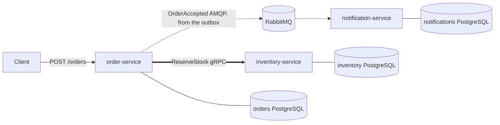

# Go Order System

[](https://github.com/mojtaba-gheytasi/go-order-system-showcase/actions/workflows/ci.yml)

A failure-aware order workflow built in Go. The business scope is intentionally narrow;
the focus is the behavior at distributed-system boundaries: concurrent reservations,
duplicate requests, lost responses, partial failures, and at-least-once delivery.

**This is a distributed-systems showcase, not a recommendation to start a product of
this size, with these requirements and constraints, using microservices.** Microservices
introduce significant complexity, and without a real need, they can create more problems
than they solve.
**In general, I prefer a modular-monolith-first approach.** I would start with a
modular-monolith and only extract a module into a separate service when there's a clear
reason, such as independent scaling, team autonomy, different reliability requirements,
or the need for a different programming language or technology.

## System overview



#### Why three services

Together, they make two different failure models concrete in one workflow:

- **Inventory (synchronous)** The order must wait for inventory confirmation before it
can be accepted.
- **Notification (asynchronous)** An accepted order does not wait for an email
provider, and a notification failure does not reverse the order.

One database per service; nothing reaches into another's. Contracts live with their
owner — commands belong to the receiver (`ReserveStock` belongs to inventory), while events
belong to the producer (`OrderAccepted` belongs to order).

## What it actually guarantees

| Boundary                | Guarantee                                                                                                 |
| ----------------------- | --------------------------------------------------------------------------------------------------------- |
| client → order          | A required `Idempotency-Key` maps repeated requests to one stored order                                   |
| order state             | Transitions use an expected status, so concurrent completions can't overwrite each other                  |
| order → inventory       | 3 attempts on `UNAVAILABLE`/`DEADLINE_EXCEEDED` (100ms, 200ms); the order id makes retries safe           |
| inventory reservation   | Atomic across all order lines, idempotent for the same order id and basket                                |
| order → RabbitMQ        | At-least-once publication: the event commits with the acceptance and is retried until routed; after 10 failed attempts it waits for a redrive |
| RabbitMQ → notification | At-least-once processing, *once the event has been routed*                                                |
| notification effect     | Best-effort deduplication by `(subject, kind, channel)`, with a fenced lease                              |
| failed notification     | 3 provider attempts, then the message parks                                                               |

## Design decisions and the failures they prevent

### 1. Stock is never overbooked, and the database is what enforces it

There is no read-then-update window. Availability and mutation happen in one statement:

```sql
UPDATE stock_items SET reserved = reserved + $2, updated_at = now()
 WHERE product_sku = $1 AND on_hand - reserved >= $2;
```

Zero affected rows means the requested quantity was unavailable. A database
`CHECK (reserved <= on_hand)` is the final guard, and the complete basket is processed
in one transaction so a failure on any line rolls back the earlier lines. This keeps the
normal contention outcome as data rather than turning it into a `SERIALIZABLE` abort that
the application must retry.

### 2. A lost inventory response is safe to retry

The order is stored as `pending` before crossing the gRPC boundary. Every attempt then
uses the same persisted order ID and item lines, and inventory records that order ID in
the same transaction that reserves stock. Repeating the same basket returns the recorded
success without moving stock again. Different lines are refused when a reservation is
already visible; the concurrent exception is documented in
[ARCHITECTURE.md](ARCHITECTURE.md#unresolved-bug-different-concurrent-baskets-can-share-an-order-id).
If the outcome remains unknown after three attempts, the order stays `pending` rather
than being guessed `accepted` or `rejected`.

### 3. Stock db rows are locked in a deterministic order

Reservation lines are canonicalized and sorted by SKU before stock rows are updated.
Without that order, concurrent baskets `[A, B]` and `[B, A]` can each hold one row while
waiting for the other. Sorting makes every transaction acquire the rows in the same
order. Removing the sort and rerunning the concurrency test reproduces PostgreSQL
`SQLSTATE 40P01`.

### 4. A transactional outbox keeps order creation independent of RabbitMQ

Order-service uses the transactional outbox pattern. Accepting an order and saving its
`OrderAccepted` event happen in one database transaction, so neither can exist without
the other. A background worker in order-service publishes the saved events afterwards.

This prevents two failures:

- **A slow or unavailable broker holding up orders.** The customer gets `201` as soon as
  the order is saved. RabbitMQ being slow or down does not delay or fail order creation.
- **A lost event.** If the service crashes right after accepting an order, or RabbitMQ is
  down, the event is still in the database and goes out later. An event is never
  silently dropped: it is retried until RabbitMQ confirms it was routed, and one that
  keeps failing is kept for a person to redrive.

A retry can publish the same event twice, which is why notification deduplicates
(decision 5). The retry policy, and how workers avoid publishing the same event at the
same time, are in
[ARCHITECTURE.md](ARCHITECTURE.md#an-accepted-orders-event-is-saved-with-it).

### 5. Notification deduplicates the effect, not the message

Different messages can request the same email, so deduplication uses the business key
`(subject_id, notification_kind, channel)` rather than the event ID. A leased claim has a
unique fencing token, and every final write includes that token; a worker whose lease
expired cannot overwrite the result of its replacement. The retry budget is stored in
PostgreSQL and increases only before a real provider call, while RabbitMQ's `x-death`
remains observability data. After three attempts, the original delivery is acknowledged
only after the parked copy has been confirmed.

### 6. Service boundaries are enforced by the toolchain

Each gRPC or event contract lives in a service-owned protobuf module. Local `replace`
directives make an incompatible contract change fail while compiling the same checkout,
and CI uses `buf breaking` to detect compatibility breaks against `main`. Each contract
also has its own Buf workspace, so one service's `.proto` cannot silently import another
service's internal contract. CI regenerates protobuf output and fails if the committed
code is stale.

These are a selection of the design decisions. **[ARCHITECTURE.md](ARCHITECTURE.md) covers
the rest, along with the alternatives I rejected and the trade-offs I accepted and why.** It
also walks through the full request flow and how each failure is handled at every boundary.

## Run locally

Requirements: Docker with Compose and `make`. No local environment file is required;
each service falls back to its committed `.env.example`.

```bash
make up
```

This builds and starts the three services, three PostgreSQL databases, migrations, the
development stock seed, and RabbitMQ. If you already have your own `order-service/.env`,
add `OUTBOX_POLL_INTERVAL=1s` and `OUTBOX_CLAIM_LEASE=30s` to it first; order-service
refuses to start without them. Submit an order:

```bash
curl -i -X POST localhost:8080/orders \
  -H 'Content-Type: application/json' \
  -H 'Idempotency-Key: demo-order-001' \
  -d '{
    "customer_id":"7bbcc589-18e9-4cad-9a4f-7f10c8f4967d",
    "customer_email":"buyer@example.com",
    "items":[{"product_sku":"SKU-A","quantity":2}]
  }'
```

A new successful request returns `201` with an `accepted` order. Then:

```bash
make notification-logs
```

shows `order confirmation email sent`.

## Test the failure paths

| Try this                             | Expected result                                           | What it demonstrates                        |
| ------------------------------------ | --------------------------------------------------------- | ------------------------------------------- |
| Send the identical request again     | `200`, the same order ID, and no second stock reservation | Client idempotency and stored-result replay |
| Order 4 units of `SKU-SCARCE`        | `409` with the complete stock shortfall                   | Atomic inventory refusal                    |
| Stop inventory, then submit an order | `503` after three attempts; the order remains `pending`   | Durable, resumable failure state            |
| `docker compose stop rabbitmq`, submit an order, then `docker compose start rabbitmq` | `201` straight away; the email is logged once RabbitMQ is back | The outbox: acceptance does not wait for the broker, and the event is not lost |


The automated tests target failure behavior: exhausted retries, stock contention,
duplicate requests, state conflicts, unroutable publications, unknown publication
outcomes, an acceptance whose event cannot be stored, outbox lease takeovers, duplicate
deliveries, expired claims, stale workers, and parking failures.
Concurrency tests release many goroutines against the same stock rows and assert the
invariant—never `reserved > on_hand`—rather than requiring one particular winner.

```bash
make test              # Unit tests across every Go module, with the race detector
make test-integration  # Real PostgreSQL and RabbitMQ through testcontainers
make check             # Compose validation, Buf lint, go vet, and unit tests
```

## Deliberate limits

- **Events that need attention wait for a person.** They are logged as errors and listed
by `make order-outbox-attention`, but nothing alerts on them, and redrive is manual.
- **No automatic recovery for pending orders yet.** A `pending` order is resumed by a later request
with the same idempotency key, but it can otherwise remain pending indefinitely.
- **No reservation expiry or release.** A reservation can remain held when the order
workflow fails after inventory succeeds.
- Reusing an idempotency key with a different request body returns the stored order;
request fingerprinting has not been added.
- The product catalog is an in-process stub, and the email provider writes to the log.
- Parked-queue depth is not connected to monitoring or alerting.

## How this was built

I developed this project with Claude Code and Codex. Claude Code was my primary environment
for planning and orchestration, while I used Codex to review plans and implement delegated
tasks through OpenAI's [Codex plugin for Claude Code](https://github.com/openai/codex-plugin-cc).

Both tools contributed code. I selected the final direction, reviewed the changes, and
verified the behavior with tests. The architectural decisions and trade-offs documented
here are the ones I chose and can defend.
