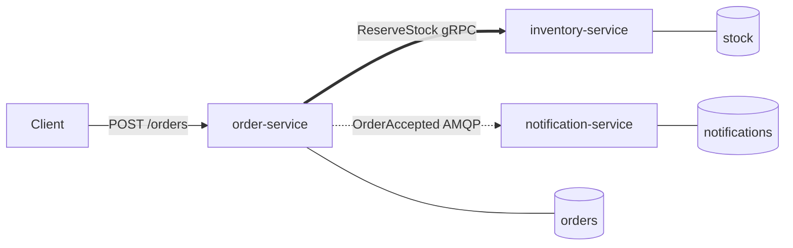

# Go Order System

[](https://github.com/mojtaba-gheytasi/go-order-system-showcase/actions/workflows/ci.yml)

Three Go services that place an order. ~7,000 lines of production code — the feature is
deliberately tiny, because what I wanted to build was everything that happens when
requests race, responses get lost, or a dependency dies halfway through.

> **A distributed-systems showcase, not a recommendation.** For this feature set a
> modular monolith is the better production choice. I would start there and extract a
> service only for team autonomy, independent scaling, a genuinely different failure
> profile, or a boundary that has held still long enough to survive becoming a network
> contract.

## Why three, then



Because it makes **two opposite failure models executable** in one workflow that I want to show how I handle in a distrubuted system:

- **`==>` inventory is synchronous.** The order cannot be accepted without its answer, so
  the client waits. Its hard problem is database contention.
- **`-.->` notification is asynchronous.** A slow email provider must never get a vote on
  whether an order was accepted. Its hard problems are retries and duplicate effects.

One database per service; nothing reaches into another's. Contracts live with their
owner — `ReserveStock` belongs to inventory (a command), `OrderAccepted`
belongs to order (an event).

## What it actually guarantees

Stated narrowly on purpose. Nothing here claims "reliable" or "exactly once."

| Boundary | Guarantee |
| --- | --- |
| client → order | A required `Idempotency-Key` maps repeated requests to one stored order |
| order state | Transitions use an expected status, so concurrent completions can't overwrite each other |
| order → inventory | 3 attempts on `UNAVAILABLE`/`DEADLINE_EXCEEDED` (100ms, 200ms); the order id makes retries safe |
| inventory reservation | Atomic across all lines, idempotent for the same order id and basket |
| order → RabbitMQ | **Best-effort publication** — there is no outbox |
| RabbitMQ → notification | At-least-once processing, *once the event has been routed* |
| notification effect | Fenced lease, deduplicated by `(subject, kind, channel)` — never by event id |
| failed notification | 3 provider attempts, then the message parks |

That fifth row is the honest one: an order can be durably accepted while its event is
lost, and a publisher-confirm timeout is genuinely **unknown** — not failed. It is the
largest gap in the system and the first thing I would close ([plan.md](plan.md)).

## The decisions worth asking me about

**Stock is never overbooked, and the database is what enforces it.** No read-then-update.
The decision and the write are one statement:

```sql
UPDATE stock_items SET reserved = reserved + $2, updated_at = now()
 WHERE product_sku = $1 AND on_hand - reserved >= $2;
```

Zero rows updated means there wasn't enough. Beneath it sits
`CHECK (reserved <= on_hand)` — every guard above that line could have a bug; that one
cannot be violated.

**`SERIALIZABLE` was rejected for adding a failure class rather than removing one.** It
aborts contenders with `40001` and expects an application retry loop, so the failure rate
climbs with load. Under `READ COMMITTED` the loser is never aborted — it is told zero
rows, which is an answer.

**Lines are sorted by SKU before anything locks.** This is the part I got wrong first:
orders `[A, B]` and `[B, A]` deadlock. I know the sort is what fixes it because deleting
it and rerunning the concurrency test produces `SQLSTATE 40P01`.

**Notification deduplicates the *effect*, not the message.** The key is
`(subject_id, notification_kind, channel)`. Two different events can describe the same
effect — a redelivery, a republish — and what must not happen twice is the email. The
claim is a fenced lease, so every finalising write carries `AND claim_token = ?` and a
worker whose lease expired cannot overwrite the result of the one that took over. Its
retry budget is an `attempts` column rather than RabbitMQ's `x-death`, because `x-death`
counts trips through the retry queue and a trip can happen without the provider ever
being called.

**Two of the three services have no `domain/` package.** My test for whether one is
earned: *can code in it return a business error?* Inventory's only invariant is about
contention, enforced by that `UPDATE` and that `CHECK` — not by an in-memory object. A
`domain/` folder there would be decoration.

**The repo layout enforces the boundaries instead of asking nicely.** `replace` directives
mean inventory deleting an RPC that order calls is a compile error *in the PR that caused
it*. Each contract is its own buf workspace on purpose, so one service's `.proto` cannot
import another's — it fails to resolve. CI regenerates and asserts the committed output
is unchanged.

## Run it

```bash
make up   # 3 services, 3 databases, migrations, stock seed, RabbitMQ. No setup — .env is optional.

curl -i -X POST localhost:8080/orders \
  -H 'Content-Type: application/json' -H 'Idempotency-Key: demo-order-001' \
  -d '{"customer_id":"7bbcc589-18e9-4cad-9a4f-7f10c8f4967d",
       "customer_email":"buyer@example.com",
       "items":[{"product_sku":"SKU-A","quantity":2}]}'
```

`201` with an `accepted` order, then `make notification-logs` shows
`order confirmation email sent`. The three things actually worth trying by hand:

| Do this | You get | Which proves |
| --- | --- | --- |
| Send the identical request again | `200`, same order id, stock not decremented twice | the idempotency key resumes a stored order |
| Order 4 of `SKU-SCARCE` (3 in stock) | `409` + `{"product_sku":"SKU-SCARCE","requested":4,"available":3}` | every shortfall is reported, not just the first |
| `docker compose stop inventory`, then order | `503` after 3 tries, order left `pending` | the failure is durable and resumable, not swallowed |

`make test` — unit, no Docker. `make test-integration` — real Postgres and RabbitMQ via
testcontainers, both `-race`. `make check` adds compose config, buf lint and vet.

The tests go after failure paths rather than lines: exhausted inventory retries,
insufficient stock, duplicate requests, state conflicts, unroutable messages, unknown
publish outcomes, duplicate deliveries, expired claims, stale workers, parking. The
concurrency ones release dozens of goroutines at the same stock rows and assert on the
invariant rather than the outcome — never `reserved > on_hand`, never a deadlock.

## Deliberate limits

No transactional outbox. No reservation expiry or release. No background recovery for
`pending` orders. A reused idempotency key with a different body returns the stored order
— no request fingerprinting. The catalog is an in-process stub with three products; the
email provider is a log adapter. Parked-queue depth is not wired to alerting.

These are listed because a guarantee is only useful when its failure boundary is visible.

## How this was built

I used AI coding tools, and [CLAUDE.md](CLAUDE.md) — the instruction file I gave them — is
committed, so you can see what I directed and what I constrained. The decisions above are
mine and I can defend any of them.

**[ARCHITECTURE.md](ARCHITECTURE.md)** is the long version: contract ownership, service
wiring, partial-failure analysis, all three RabbitMQ delivery outcomes, notification
fencing, and the full contention walkthrough.
